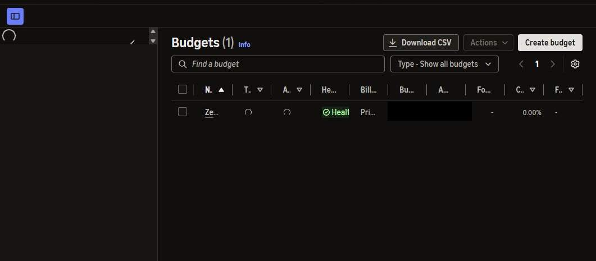
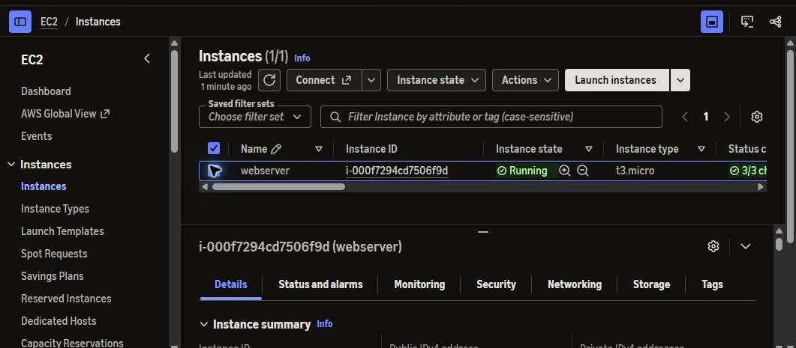
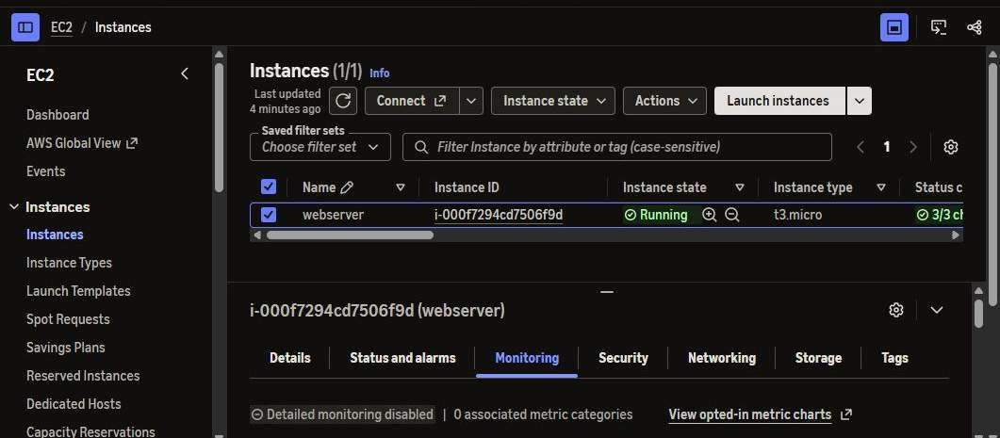
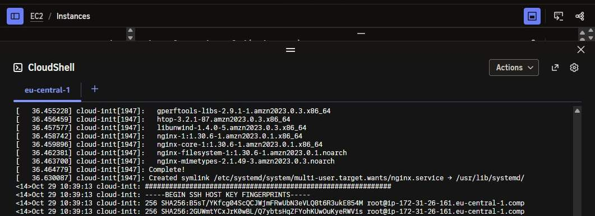
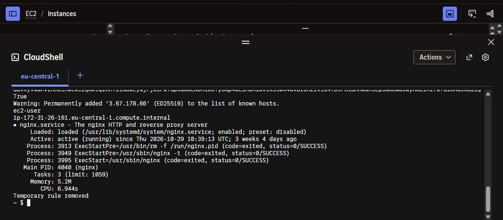
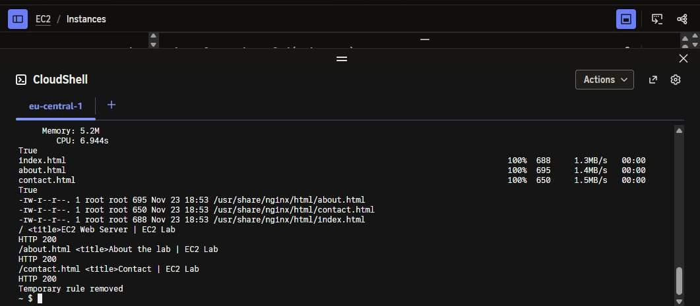
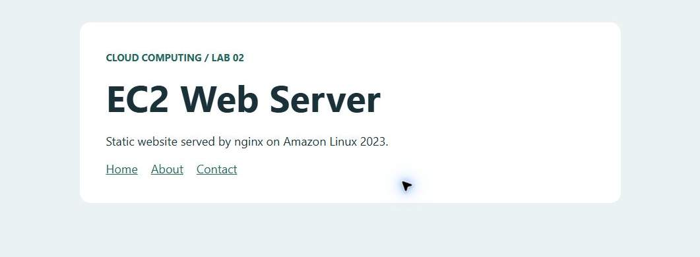
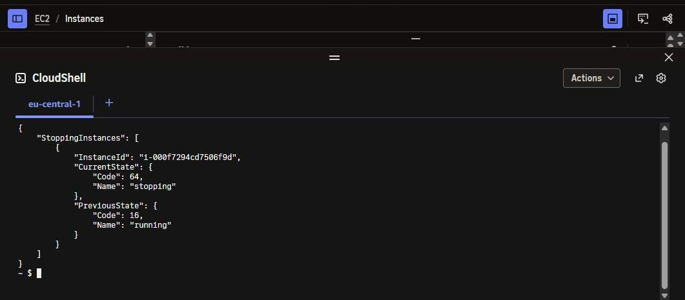
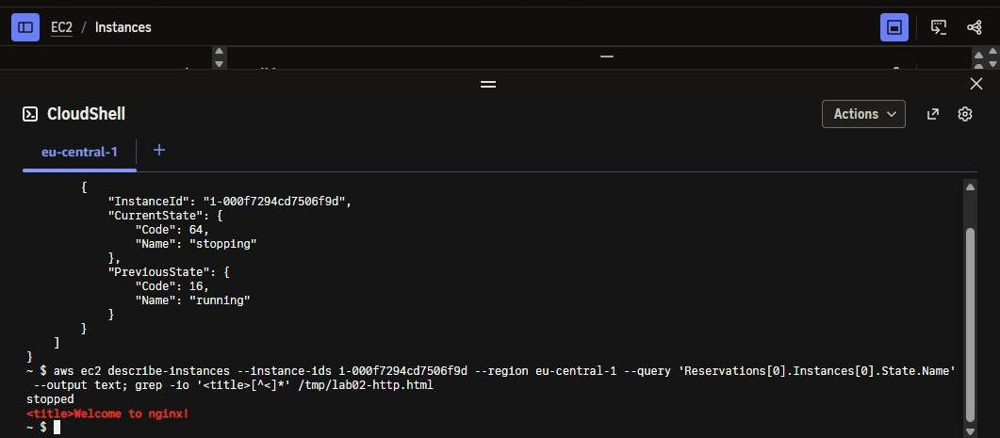
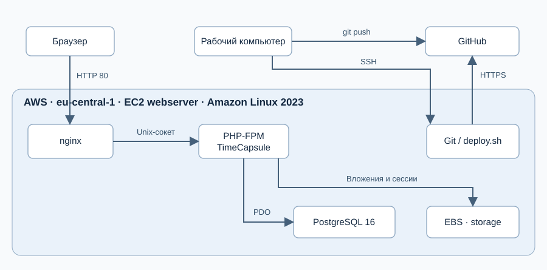

# Лабораторная работа №2 - Облачные вычисления

| | |
| --- | --- |
| Тема | Веб-сервер на Amazon EC2 |
| Студент | Максим Орлов |
| Группа | IA-2404 |
| Уровень | Продвинутый, задания 1-14 |
| Приложение | TimeCapsule, PHP functional |
| Деплой | Вариант B, deploy.sh по SSH |

## Цель работы

Настроить веб-сервер nginx в Amazon EC2, разместить на нём статический сайт, проверить доступность страниц и остановить экземпляр через AWS CLI. Затем развернуть TimeCapsule с PostgreSQL, доставить обновление из GitHub и проверить восстановление после ошибки.

[Задание в Moodle](https://elearning.usm.md/mod/assign/view.php?id=315493)

## 1. Учётная запись AWS и бюджет

Создал бюджет `ZeroSpend` в AWS Budgets для контроля расходов на ресурсы лабораторной. В IAM создал отдельного пользователя `cloudstudent` для работы с AWS.

Для заключительной проверки в консоли AWS и CloudShell использовал сессию владельца аккаунта (root). Отдельный вход в консоль под `cloudstudent` в отчёте не подтверждён. Для входа в Linux использовал учётную запись `ec2-user`.



**Для чего нужна политика AdministratorAccess?** Она даёт пользователю или роли IAM широкие административные права. Некоторые операции доступны только владельцу аккаунта. Для повседневных задач используют учётные записи IAM с правами, необходимыми для этих задач.

## 2. Экземпляр EC2 и nginx

Создал экземпляр EC2 с именем `webserver`. Выбрал образ Amazon Linux 2023, тип `t3.micro`, регион Франкфурт (`eu-central-1`) и зону доступности `eu-central-1a`.

Настроил группу безопасности `webserver-sg`. Открыл входящий TCP-порт 80 для проверки сайта из браузера. Доступ на TCP-порт 22 для SSH ограничил по IP-адресу источника. После запуска дождался состояния `Running` и прохождения всех трёх проверок состояния. Для HTTP-проверки использовал публичный IPv4-адрес `3.67.178.66`.



При первом запуске настроил установку пакетов `nginx` и `htop` и включение службы nginx. Результат установки и включения службы проверил в системном журнале `cloud-init`. Перед загрузкой сайта сервер вернул код `HTTP 200`, а у сохранённой страницы был заголовок `Welcome to nginx!`. Этот заголовок виден на последнем снимке в разделе 6.

**Когда выполняется скрипт User Data?** В стандартной конфигурации Amazon Linux его запускает `cloud-init` при первой загрузке экземпляра. При последующей остановке и запуске скрипт по умолчанию повторно не выполняется.

## 3. Мониторинг и системный журнал

Режим мониторинга проверил на вкладке **Monitoring**. Чтобы проверить установку пакетов, получил системный журнал командой `aws ec2 get-console-output --latest`.





**Что показывают проверки состояния EC2?** Системная проверка следит за инфраструктурой AWS, на которой работает экземпляр. Проверка экземпляра определяет, отвечает ли гостевая система. Проверка подключённых томов EBS оценивает их доступность.

**Что даёт подробный мониторинг?** Для большинства метрик EC2 базовый режим публикует данные раз в пять минут, а подробный - раз в минуту. Во время лабораторной был включён базовый режим.

## 4. Подключение по SSH

В AWS CloudShell создал временную пару ключей и передал открытый ключ через EC2 Instance Connect. На время подключения разрешил SSH с одного IP-адреса источника. После входа под `ec2-user` команда `systemctl status nginx` показала `active (running)`. По завершении удалил временное правило доступа и файлы временных ключей.



**Зачем нужен ключ SSH?** При аутентификации клиент подтверждает, что владеет закрытым ключом, соответствующим открытому ключу. Закрытый ключ остаётся у клиента. В этой работе EC2 Instance Connect предоставил серверу открытый ключ на время подключения.

## 5. Публикация сайта

Подготовил три связанные HTML-страницы: главную, страницу о лабораторной работе и страницу контактов. Передал файлы через `scp` и разместил их в каталоге `/usr/share/nginx/html`, из которого nginx отдаёт страницы. Командой `ls -l` проверил, что все файлы на месте. Отправил отдельный HTTP-запрос к каждой странице и открыл главную страницу в браузере по публичному IP-адресу экземпляра.

| Файл | Страница | Результат |
| --- | --- | --- |
| `index.html` | Главная | HTTP 200 |
| `about.html` | О работе | HTTP 200 |
| `contact.html` | Контакты | HTTP 200 |





**Чем отличаются SSH и SCP?** SSH позволяет открыть сеанс на удалённом сервере или выполнить на нём команду. SCP копирует файлы через SSH-соединение.

## 6. Остановка экземпляра

Остановил экземпляр из AWS CloudShell и проверил итоговое состояние через AWS CLI.

```bash
aws ec2 stop-instances --instance-ids i-000f7294cd7506f9d --region eu-central-1 --no-cli-pager

aws ec2 describe-instances --instance-ids i-000f7294cd7506f9d --region eu-central-1 \
  --query 'Reservations[0].Instances[0].State.Name' --output text
```

Первая команда показала переход из состояния `running` в `stopping`. Повторная проверка вернула `stopped`. Заголовок стандартной страницы nginx на последнем снимке прочитан из HTML-файла, сохранённого до публикации сайта.





**Что сохраняется после остановки?** Экземпляр с томом EBS можно запустить снова, при этом файлы на томе сохраняются. При удалении экземпляра загрузочный том может быть удалён в зависимости от настроек. За вычислительные ресурсы остановленного экземпляра плата не начисляется. Хранение томов EBS и других сохранённых ресурсов может по-прежнему оплачиваться. После запуска автоматически назначенный публичный IPv4-адрес может измениться.


## 7. Репозиторий приложения

Взял учебный вариант [open_capsules_php_functional](https://github.com/msu-cloud-course/app-samples/tree/0da0c0b7539ea128e3c20d00e3d81ec8d9bedb15/open_capsules_php_functional). Исходники и скрипт находятся в [каталоге timecapsule](timecapsule/). По выбранной схеме публикации код и отчёт лежат в публичном репозитории Cloud-Computing рядом с остальными лабораторными.

## 8. Подготовка EC2

Повторно запустил экземпляр `webserver` из базовой части. Подключился по SSH через EC2 Instance Connect и установил Git, Composer, PostgreSQL 16, PHP-FPM и PHP 8.4 с расширениями PostgreSQL, mbstring и XML. В терминале PHP показал версию `8.4.27`, а менеджер пакетов показал PostgreSQL `16.15`.

**Почему установка выполнялась вручную?** На сервере уже работал nginx из первой части. Ручная установка позволила использовать тот же экземпляр и проверить каждый шаг до перехода к следующему. User data подойдёт для повторяемого начального развёртывания нового экземпляра.

## 9. PostgreSQL

Инициализировал каталог данных, запустил службу PostgreSQL и включил проверку пароля SCRAM для локальных TCP-подключений. Создал отдельную роль и базу `timecapsule`, владельцем которой стала эта роль. База доступна приложению по `127.0.0.1:5432`.

```text
?column?
--------
       1
(1 row)
```

Этот результат получен командой `psql` с пользователем `timecapsule` и запросом `SELECT 1;`.

## 10. Исходники и схема

Склонировал публичный репозиторий по HTTPS в `/var/www/cloud-computing`. Настроил локальный `.env`, установил зависимости командой `composer install --no-dev --optimize-autoloader --no-interaction` и выполнил `php bin/init-db.php`. Скрипт напечатал `Database is ready (127.0.0.1).`

**Почему конфигурация лежит на сервере?** Пароль нужен приложению во время работы, а его публикация раскрыла бы доступ. Поэтому `.env` исключён из Git и на EC2 доступен владельцу и группе Apache. Публичный репозиторий содержит код и шаблон конфигурации без рабочего пароля. PHP-FPM пишет пользовательские файлы и сессии в локальный каталог `storage`.

## 11. PHP-FPM и nginx

Настроил nginx на каталог `lab-02/timecapsule/public`. Запросы к приложению идут в `index.php` через сокет `/run/php-fpm/www.sock`. Проверка `sudo nginx -t` прошла, после чего перезагрузил конфигурацию nginx.

Проверил публичный адрес EC2 из AWS CloudShell. Эндпоинт `GET /health` вернул HTTP 200 и JSON со значениями `"status":"ok","db":"ok"`. Через HTTP зарегистрировал тестового пользователя и создал капсулу `/capsules/1` с PNG. Встроенный браузер заблокировал открытие публичного HTTP-адреса, поэтому проверки продвинутой части приведены выводом команд и HTTP-запросов.

## 12. Обновление по SSH, вариант B

Из SSH-сеанса выполнил [deploy.sh](timecapsule/deploy.sh). Скрипт получает изменения через `git pull --ff-only`, устанавливает зависимости из `composer.lock`, перечитывает конфигурацию PHP-FPM и печатает развёрнутый коммит.

```text
```

**Что увидит посетитель во время деплоя?** Обновление файлов происходит на месте, поэтому запрос может попасть между обновлением кода и зависимостей и закончиться ошибкой. Если Composer завершится с ошибкой, скрипт остановится, но Git уже может указывать на новый коммит. Атомарное переключение каталогов релизов после проверки зависимостей уменьшило бы этот риск.

## 13. Новая версия, ошибка и откат

Добавил подпись в подвал страницы и повторил деплой. Запрос с той же сессией подтвердил подпись «Максим Орлов · ЛР2» на странице существующей капсулы. После наступления времени открытия вложение скачалось с исходным SHA-256.

```text
/capsules/1      HTTP 200, подпись видна
/capsules/1/file HTTP 200
SHA-256: 22056e41cc4106ac582c0cc793e17b2b138ad590685718c387c4d091ae8fa75d
```

Автоматическая проверка GitHub отклонила публикацию синтаксически сломанного шаблона в `main`. Ошибку и откат проверил отдельным Git-клоном на том же EC2, где PHP обслуживал только `127.0.0.1:8081`. В локальном клоне записал ошибку в отдельный коммит и выполнил `git revert --no-edit HEAD`.

```text
Before: HTTP 200
Broken 38c819b: HTTP 500
Revert 46a0664: HTTP 200
```

**Почему /health может отвечать 200, если страницы не работают?** Этот маршрут проверяет запрос к таблице `users` и возвращает JSON без использования общего HTML-шаблона. Для обнаружения сбоя в шаблоне нужна отдельная проверка маршрута, который отображает страницу.

**Сколько длился сбой?** Публичный сайт продолжал работать. В изолированном тесте сбой длился между применением сломанного коммита и завершением `git revert`. Точную длительность не измерял. Проверка `php -l` до развёртывания обнаружила бы эту ошибку до открытия релиза для посетителей.

## 14. Архитектура и решение



[ADR-0001. Доставка кода TimeCapsule на EC2](../docs/adr/0001-deploy-method.md)

## Дополнительные контрольные вопросы

**Как проходит запрос от браузера до БД?** Браузер обращается к публичному HTTP-адресу nginx. Для маршрутов приложения nginx передаёт запрос PHP-FPM через Unix-сокет. PHP выполняет код TimeCapsule и обращается к локальной PostgreSQL через PDO.

**Почему сервер может скачивать код из GitHub?** Публичный репозиторий доступен для чтения по HTTPS без авторизации. Запись требует подходящих учётных данных, которых для деплоя на сервере не устанавливал. Это ограничивает последствия компрометации EC2 для репозитория.

**Что произойдёт с файлами при удалении EC2?** Вложения хранятся в `storage/uploads` на диске экземпляра. При остановке EBS сохраняется. При удалении экземпляра дальнейшая судьба файлов зависит от параметра удаления EBS-тома и наличия резервной копии.

**Что общего с CI/CD?** Скрипт выполняет повторяемый набор шагов для конкретного коммита, с проверкой результата каждой операции. Для CI/CD недостаёт автоматического запуска по событиям GitHub, предварительных тестов, проверки приложения после обновления и автоматического возврата к рабочему релизу.

## Завершение

Удалил временное правило SSH для EC2 Instance Connect, убрал временные клиентские артефакты проверки и отправил команду остановки EC2 через AWS CLI. AWS CLI подтвердил состояние `stopped`. Конфигурация TimeCapsule, PostgreSQL и данные тестовой капсулы сохранены на EBS.
