# Лабораторная работа №3 - Облачные сети. Amazon VPC

| Параметр | Значение |
| --- | --- |
| Студент | Максим Орлов |
| Группа | IA-2404 |
| Уровень | Продвинутый, задания 1-14 |
| Номер для расчёта | 7 |
| Регион | Франкфурт, `eu-central-1` |

[Условие задания в Moodle](https://elearning.usm.md/mod/assign/view.php?id=341384)

## 1. План адресов

При `k = 7` получается `X = 7 % 30 = 7`. Диапазон VPC `timecapsule-dev-vpc` - `10.7.0.0/16`.

| Подсеть | Зона | CIDR | Первый доступный | Последний доступный | Адресов |
| --- | --- | --- | --- | --- | --- |
| `public-a` | `eu-central-1a` | `10.7.0.0/24` | `10.7.0.4` | `10.7.0.254` | 251 |
| `public-b` | `eu-central-1b` | `10.7.1.0/24` | `10.7.1.4` | `10.7.1.254` | 251 |
| `private-a` | `eu-central-1a` | `10.7.10.0/24` | `10.7.10.4` | `10.7.10.254` | 251 |
| `private-b` | `eu-central-1b` | `10.7.11.0/24` | `10.7.11.4` | `10.7.11.254` | 251 |

**Почему доступен 251 адрес?** AWS резервирует `.0` как адрес сети, `.1` для маршрутизатора VPC, `.2` для DNS, `.3` для будущего использования и `.255` как широковещательный адрес. В диапазоне `/16` помещается 256 блоков `/24`, поэтому адресное пространство позволяет добавить ещё 252 блока. Число реально создаваемых подсетей также ограничивается квотой AWS.

## 2. VPC и подсети

Создал VPC отдельно от сети лабораторной №2. Включил DNS resolution и DNS hostnames, затем создал четыре подсети в двух зонах. Ресурсам назначал теги `Name=timecapsule-dev-<роль>`, `Project=timecapsule`, `Environment=dev`, `Owner=maximaxx44` и `Lab=lab3`.

**Была ли `public-a` публичной сразу после создания?** Нет. На этом этапе таблица маршрутов содержала только локальный маршрут, а имя подсети на маршрутизацию не влияет. Чтобы подсеть стала публичной, нужна связь с таблицей, в которой есть маршрут к Internet Gateway.

## 3. Шлюз и маршруты

Подключил `timecapsule-dev-igw` к VPC. Связал обе публичные подсети с `timecapsule-dev-public-rt` и включил для них автоматическую выдачу публичных IPv4. Обе приватные подсети связал с `timecapsule-dev-private-rt`. В финальном состоянии у приватной таблицы остался только локальный маршрут.

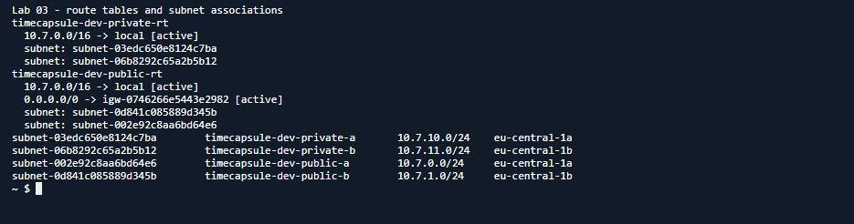

Таблицы AWS показывают локальный маршрут в обеих группах подсетей и маршрут через IGW только в публичной.

**Что даёт маршрут `local`?** Маршрут `10.7.0.0/16 -> local` обеспечивает обмен между подсетями VPC, в том числе между зонами доступности. Адрес `8.8.8.8` не входит в этот диапазон. При финальной конфигурации подходящего маршрута из `private-a` нет, поэтому пакет не выходит в интернет.

## 4. Группы безопасности

| Группа | Входящие правила |
| --- | --- |
| `timecapsule-dev-bastion-sg` | TCP 22 с одного адреса CloudShell, `/32` |
| `timecapsule-dev-web-sg` | TCP 80 от `0.0.0.0/0`, TCP 22 от группы bastion |
| `timecapsule-dev-db-sg` | TCP 5432 от группы web, TCP 22 от группы bastion |

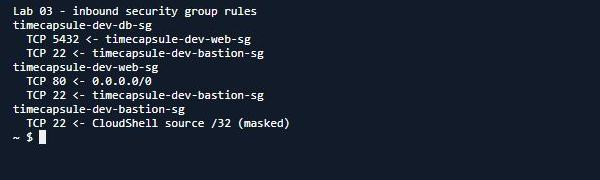

Входящие правила трёх групп получены через AWS CLI. Адрес источника SSH скрыт.

**Зачем ссылаться на группу web?** Правило продолжит работать при смене IP веб-сервера. Оно разрешает соединения ресурсам с нужной группой, тогда как источник `10.7.0.0/16` дал бы доступ любому узлу VPC при выполнении остальных условий.

## 5. Экземпляры и SSH

| Экземпляр | Подсеть | Частный IPv4 | Публичный IPv4 при запуске |
| --- | --- | --- | --- |
| `timecapsule-dev-bastion` | `public-b` | `10.7.1.10` | Выдаётся автоматически |
| `timecapsule-dev-web` | `public-a` | `10.7.0.10` | Выдаётся автоматически |
| `timecapsule-dev-db` | `private-a` | `10.7.10.10` | Отсутствует |

Запустил три `t3.micro` с Amazon Linux 2023. Через User Data установил nginx на веб-сервере и создал страницу с именем и частным IP сервера. По SSH подключился к bastion из CloudShell, а к web и db - через `ProxyJump bastion`. На экземплярах указал пару ключей из лабораторной №2, для текущих проверок использовал отдельный временный ключ из CloudShell.

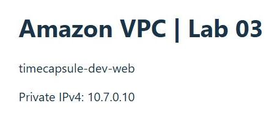

На странице видны имя веб-сервера и адрес `10.7.0.10`.

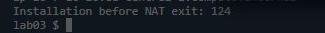

SSH до базы работал через bastion, но установка PostgreSQL без доступа к репозиторию завершилась по тайм-ауту с кодом 124.

**Почему веб-сервер скачивал пакеты, а сервер базы не мог?** У веб-сервера есть публичный IPv4 и маршрут через Internet Gateway. Для временного исходящего доступа из приватной подсети нужен NAT Gateway в публичной подсети и маршрут на него. Входящие подключения из интернета к базе через NAT Gateway не инициируются.

## 6. Временный NAT и PostgreSQL

В `public-a` создал зональный публичный NAT Gateway `timecapsule-dev-nat-a`, выделил ему Elastic IP и временно направил `0.0.0.0/0` из приватной таблицы на NAT. На сервере базы проверил исходящий адрес командой `curl https://checkip.amazonaws.com`, установил `postgresql16-server`, инициализировал каталог данных и включил службу. Для подключения создал базу `lab3`, роль `student` и разрешил аутентификацию SCRAM из `10.7.0.0/24` через `pg_hba.conf`.

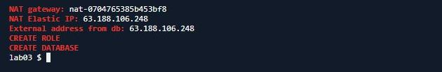

Адрес из запроса на сервере базы совпал с Elastic IP NAT Gateway.

**Почему внешний адрес принадлежит шлюзу?** PostgreSQL-сервер использует приватный адрес `10.7.10.10`. NAT подменяет исходный адрес при выходе в интернет, поэтому внешний сервис видит Elastic IP шлюза.

**Как ограничен доступ к базе?** Публичного IPv4 и прямого маршрута из интернета нет. Группа безопасности пропускает на TCP 5432 только группу веб-сервера, а PostgreSQL дополнительно проверяет подсеть, базу, роль и пароль. Ошибка в одном слое может открыть лишний путь на этом слое, но остальные ограничения продолжают действовать.

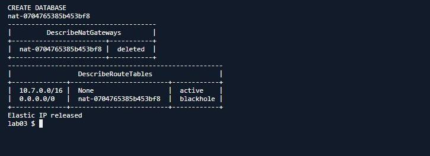

После удаления шлюза AWS показал состояние `deleted`, а маршрут - `blackhole`. Затем я удалил маршрут и освободил Elastic IP.

**Почему PostgreSQL работает без NAT?** Веб-сервер обращается к базе по приватному адресу через `local`. Для загрузки обновлений из внешних репозиториев понадобится снова временно настроить исходящий доступ и убрать его после обновления.

## 7. Проверка доступа и завершение

| Проверка | Результат |
| --- | --- |
| Запрос к nginx по публичному IPv4 | HTTP 200 |
| `SELECT version()` с веб-сервера | PostgreSQL 16.16 |
| TCP 5432 с веб-сервера | Открыт |
| TCP 5432 с bastion | Закрыт |
| `curl -m 5 https://github.com` с базы без NAT | Тайм-аут, код 28 |

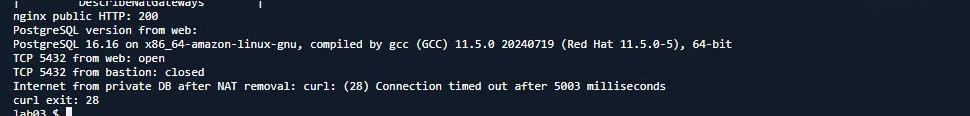

Веб-сервер подключается к базе, bastion не проходит проверку TCP 5432, а база после удаления NAT не выходит в интернет.

**Почему bastion не подключается к PostgreSQL?** Локальный маршрут есть, но группа bastion отсутствует в источниках для TCP 5432. Из интернета подключиться нельзя: у базы нет публичного IPv4 и входящего маршрута через IGW, а группа безопасности ограничивает источники.

### Эксперимент с Network ACL

Добавил входящее правило `90 Deny` для одного адреса CloudShell. С этого адреса HTTP перестал отвечать, а SSH на bastion перестал подключаться. Во время действия правила независимый запрос из CloudShell в Ирландии получил `HTTP 200`. После удаления правила HTTP и SSH восстановились и для первого источника.

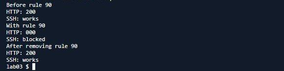

Снимок показывает, как менялся доступ с адреса, для которого применялся запрет.

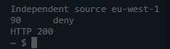

Повторный тест из другой сети показал действующее правило `90 deny` и ответ `HTTP 200`.

**Почему блокировались и HTTP, и SSH?** Network ACL фильтрует трафик на уровне подсети. Правило `90` проверяется раньше разрешающего правила `100` и блокирует весь трафик с указанного адреса. У другого источника IP отличался, поэтому запрет на него не распространялся.

**Зачем нужны теги?** По сочетанию `Project=timecapsule`, `Environment=dev` и `Lab=lab3` можно найти ресурсы работы в регионе. `Owner` помогает определить ответственного, даже если позднее ресурсы попадут в общий аккаунт.

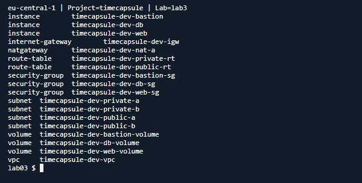

Список получен через Resource Groups Tagging API с фильтрами по проекту и номеру работы. В веб-интерфейсе Tag Editor переход открыл Resource Search, где свежие ресурсы по этому фильтру ещё не отображались.

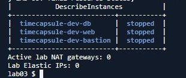

Три экземпляра остановлены. В VPC лабораторной нет действующих NAT Gateway, Elastic IP лабораторной освобождён. Сеть, группы безопасности и диски оставлены для дальнейшей работы. Экземпляр из лабораторной №2 не изменял.


## 8. Перенос TimeCapsule в VPC

Запустил исходный `webserver` из ЛР2 и проверил `/health`. Создал AMI `timecapsule-dev-app-lab2` и запустил из него `timecapsule-dev-app` типа `t3.micro` в `public-a`. Его приватный адрес - `10.7.0.20`, группа безопасности - `timecapsule-dev-web-sg`. Для настройки подключался к приложению по SSH через `timecapsule-dev-bastion`.

AMI перенёс nginx, PHP-FPM, рабочий каталог Git, зависимости Composer, конфигурацию, локальный PostgreSQL и файлы вложений. При первом запуске база ЛР2 уже находилась на диске нового EC2. После миграции она выключена, а приложение обращается к PostgreSQL на отдельной машине.

## 9. Постоянный публичный адрес

Выделил `timecapsule-dev-app-eip`, привязал его к `timecapsule-dev-app` и обновил `APP_URL`. HTTP-проверка из внешней среды по этому адресу подтвердила доступность приложения. Страницу входа также открыли в Chrome по адресу `http://18.157.155.57/login`.


Elastic IP сохраняет адрес между остановками EC2. У бастиона пользователи приложения не работают, поэтому ему хватает обычного публичного адреса на время администрирования. Elastic IP тарифицируется и при остановленном EC2. Когда доступ пойдёт через ALB, пользователи смогут обращаться к DNS-имени балансировщика.

## 10. PostgreSQL на приватном сервере

На `timecapsule-dev-db` создал базу и роль `timecapsule` с новым паролем. В конфигурации PostgreSQL для приложения разрешил только эту пару базы и роли из `10.7.0.0/24` с SCRAM:

```text
host timecapsule timecapsule 10.7.0.0/24 scram-sha-256
```

Security Group разрешает TCP 5432 от группы приложения. Проверка пароля остаётся отдельным уровнем защиты. Если злоумышленник получит доступ внутрь разрешённой сети, из этого ещё не следует доступ к данным PostgreSQL.

## 11. Приватный DNS Route 53

Связал приватную зону `timecapsule.internal` с `timecapsule-dev-vpc`. Создал запись `db.timecapsule.internal` типа A с TTL 60 и значением `10.7.10.10`.

```text
app-server: 10.7.10.10 STREAM db.timecapsule.internal
внешняя среда CloudShell: unresolved
```

Проверка разрешения имени на Windows была недоступна в текущей среде, поэтому внешний запрос выполнил из CloudShell вне VPC. Приватную зону обслуживает резолвер связанной VPC. Если приватный IP сервера базы изменится, достаточно обновить запись A. Настройка `DB_HOST` сохранит прежнее имя.

## 12. Перенос данных и переключение приложения

Выполнил `pg_dump -Fc` для локальной базы и восстановил архив через `pg_restore --single-transaction --exit-on-error` по приватной сети. Сравнил количество записей, затем задал `DB_HOST=db.timecapsule.internal` и новый пароль в локальном `.env`. Перечитал конфигурацию PHP-FPM и выключил локальный PostgreSQL на сервере приложения.

```text
Source users|capsules: 4|1
Destination users|capsules: 4|1
Local PostgreSQL: inactive
GET /health: HTTP 200, status=ok, db=ok
```

PNG сохранился в `storage/uploads` на EBS приложения вместе с копией диска. Его SHA-256 совпал с результатом ЛР2: `22056e41cc4106ac582c0cc793e17b2b138ad590685718c387c4d091ae8fa75d`. Удаление диска приложения без резервной копии приведёт к потере вложений. Данные капсулы в базе переживут такое удаление.

## 13. Обновление и проверка отказа

Добавил подпись `LR3` в подвал и развернул обновление существующим `deploy.sh` через бастион. HTTP-запрос к странице входа показал подпись. Скрипт не менял, так как он запускается внутри app-server и обновляет код через Git независимо от маршрута SSH.

Остановил экземпляр `timecapsule-dev-db`, повторил запросы и снова запустил базу. Приватный адрес сохранился.

| Проверка | Результат |
| --- | --- |
| `/health` до остановки базы | HTTP 200 |
| `/health` с остановленной базой | HTTP 500 |
| Главная страница с остановленной базой | HTTP 500 |
| `/health` после запуска базы | HTTP 200 |

Для обслуживания создал временный NAT Gateway в `public-a` и маршрут `0.0.0.0/0` в приватной таблице. Операции выполнил вручную через AWS CLI в CloudShell. Проверка с сервера базы показала исходящий IPv4 NAT, а `sudo dnf -y update` завершилась сообщениями `Nothing to do` и `Complete!`. Удалил временный маршрут и NAT, затем дождался статуса `deleted` и освободил его Elastic IP. Шлюз использует адрес до окончания удаления, поэтому освобождать адрес нужно после этого перехода.

## 14. Архитектура и решение

Ниже показаны сеть, путь пользовательского HTTP и подключения к PostgreSQL, а также временный NAT для обслуживания.

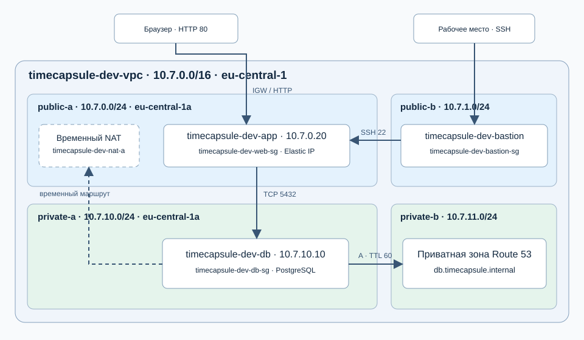

[ADR-0002. Размещение базы данных](../docs/adr/0002-database-placement.md)

### Дополнительные контрольные вопросы

**Как идёт запрос до базы?** Браузер подключается к Elastic IP по TCP 80 через Internet Gateway. Группа приложения пропускает HTTP на nginx, а PHP-FPM соединяется с базой через локальный маршрут VPC и DNS Route 53. База проверяет источник соединения через Security Group, затем роль и пароль через PostgreSQL.

**Достаточно ли знать IP базы?** Нужен сетевой путь в VPC и разрешённый источник TCP 5432. PostgreSQL также требует подходящие базу, роль и пароль. SSH на сервере базы доступен через группу бастиона.

**В чём разница между временным и постоянным NAT?** Временный шлюз оплачивается в течение окна обслуживания и пропускает исходящий трафик, пока существует маршрут на него. При следующем обновлении шлюз и маршрут нужно создать заново, дождаться готовности и убрать после работы.

**Как пережить отказ зоны?** Понадобятся балансировщик и экземпляры приложения в двух зонах, отказоустойчивая конфигурация базы и общие хранилища для вложений и сессий. В текущей схеме и приложение, и база размещены в `eu-central-1a`.

## Скриншоты продвинутой части

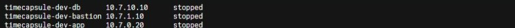

Остановленные серверы приложения, базы и бастиона.

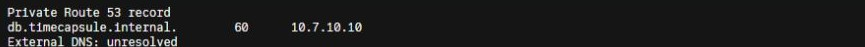

Запись приватной зоны Route 53 и внешний DNS-запрос.

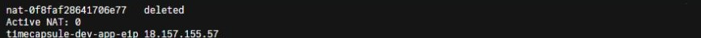

Удалённый NAT и Elastic IP приложения.


Экземпляр приложения и его AMI.

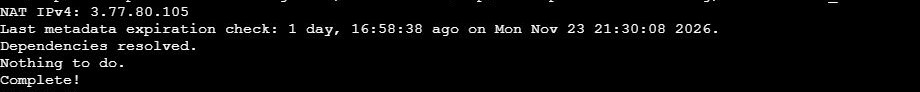

Проверка исходящего адреса NAT и обновление PostgreSQL-сервера.

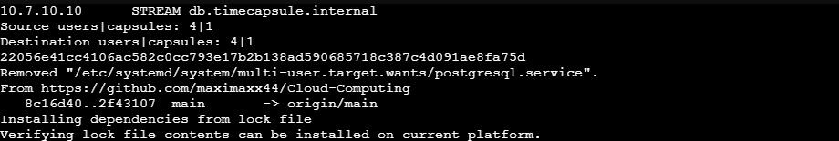

Совпадение числа записей и контрольная сумма вложения.


HTTP 500 при остановленной базе.


HTTP 200 и подпись LR3 после запуска базы.

## Завершение

Финальные проверки выполнены запросами HTTP, AWS CLI и выводом SSH. Временные SSH-правила сняты, NAT и его IP удалены. Elastic IP приложения и приватная зона сохраняются для следующих работ.

AWS подтвердил остановку `timecapsule-dev-bastion`, `timecapsule-dev-app` и `timecapsule-dev-db`. После проверки переноса завершил исходный `webserver` ЛР2. Временный AMI `timecapsule-dev-app-lab2` снял с регистрации и удалил его EBS-снимок. Скриншот AMI выше фиксирует состояние до очистки.
