# Лабораторная работа №4 - Облачные хранилища. Amazon S3

| Параметр | Значение |
| --- | --- |
| Студент | Максим Орлов |
| Группа | IA-2404 |
| Уровень | Продвинутый, задания 1–14 |
| Регион | Франкфурт, `eu-central-1` |

[Условие задания в Moodle](https://elearning.usm.md/mod/assign/view.php?id=342402)

## 1. Бакет и объекты

Создан бакет общего назначения `timecapsule-dev-uploads-maximaxx44`. Использованы настройки бакета по умолчанию для отключения ACL, блокировки публичного доступа и шифрования SSE-S3. Добавлены теги `Project=timecapsule`, `Environment=dev`, `Owner=maximaxx44`, `Lab=lab4`. Файлы загружены через CloudShell.

| Ключ | Назначение |
| --- | --- |
| `uploads/sample.png` | Тестовое изображение |
| `uploads/sample.pdf` | Тестовый PDF |
| `backups/backup.txt` | Тестовая резервная копия |

Анонимный запрос к Object URL изображения вернул HTTP 403. Браузер при таком запросе не передаёт AWS-подпись владельца. Папки представлены префиксами ключей. При создании пустой папки консоль записывает объект-маркер с ключом, оканчивающимся на `/`.

## 2. Работа с объектами через CLI

Команда `aws s3 ls s3://$BUCKET` показала `PRE backups/` и `PRE uploads/`. При просмотре `s3://$BUCKET/uploads/` видны имена объектов внутри префикса и вложенные префиксы. Флаг `--recursive` показывает полные ключи, в том числе `uploads/2026/10/report.txt`.

| Ключ | Content-Type | ETag | Размер |
| --- | --- | --- | ---: |
| `uploads/sample.png` | `image/png` | `000a1f57804c601cd0dac914370015a4` | 68 Б |
| `uploads/2026/10/report.txt` | `text/plain` | `b226e1a3649a6073b10d77b8cc66d8f5` | 15 Б |

После скачивания `photo.txt` команда `cat downloaded.txt` вывела `photo placeholder`. Команда `aws s3 rm` скрыла `uploads/2026/10/report-2.txt`, а повторный листинг этого префикса показал `report.txt`.

AWS CLI определил MIME-тип текстового файла по расширению. Метаданные получены командой `aws s3api head-object` без скачивания содержимого.

## 3. Политика HTTPS

```json
{
  "Version": "2012-10-17",
  "Statement": [
    {
      "Sid": "DenyInsecureTransport",
      "Effect": "Deny",
      "Principal": "*",
      "Action": "s3:*",
      "Resource": [
        "arn:aws:s3:::timecapsule-dev-uploads-maximaxx44",
        "arn:aws:s3:::timecapsule-dev-uploads-maximaxx44/*"
      ],
      "Condition": {
        "Bool": {
          "aws:SecureTransport": "false"
        }
      }
    }
  ]
}
```

Политика применена. Авторизованный список объектов по HTTPS получен. Явный `Deny` имеет приоритет над разрешением администратора, когда условие истинно. `Principal: "*"` задаёт область запрета и сам по себе не предоставляет публичного доступа. Повторил команду с `--endpoint-url http://s3.eu-central-1.amazonaws.com`. S3 вернул `AccessDenied` при вызове `ListObjectsV2`.

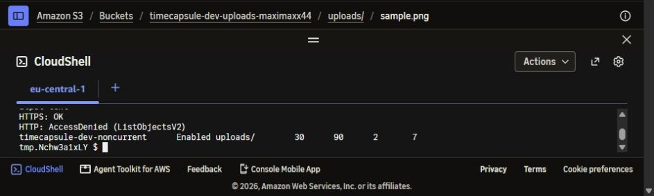

## 4. Версионирование

В консоли S3 загрузил `v1` и `v2` файла `uploads/notes.txt` под одним ключом. Удалил объект с выключенным `Show versions`, после чего он исчез из обычного списка. В `Show versions` появился активный `Delete marker`, а обе версии остались в истории. Удалил только маркер, и текущей снова стала `v2`. Затем удалил конкретную `v2`, и консоль показала, что текущей снова стала исходная `v1`. При отдельной проверке через CLI содержимое файла после этих двух этапов было `v2` и `v1` соответственно.

| Действие | Результат AWS |
| --- | --- |
| Удаление без указания версии | Создан маркер удаления, `HeadObject` вернул `404` |
| Удаление маркера по `VersionId` | Файл снова доступен, содержимое `v2` |
| Удаление `v2` по `VersionId` | Исходная `v1` стала текущей |

Удаление конкретной версии по `VersionId` безвозвратно удаляет данные этой версии. Обычное удаление в бакете с включённым версионированием скрывает объект за маркером, сохраняя данные. Для роли приложения следует ограничить `s3:DeleteObjectVersion`.

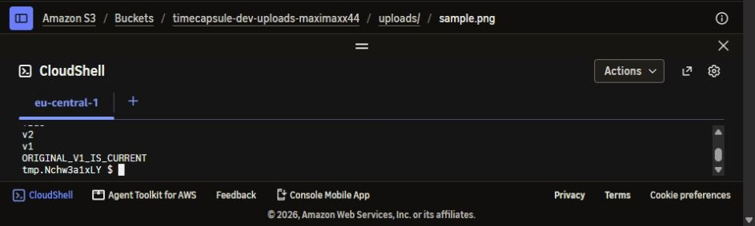

## 5. Жизненный цикл

| Параметр | Значение |
| --- | --- |
| Правило | `timecapsule-dev-noncurrent` |
| Префикс | `uploads/` |
| Переход неактуальных версий в Standard-IA | После 30 дней |
| Удаление неактуальных версий | После 90 дней с сохранением двух наиболее новых |
| Отмена незавершённых multipart-загрузок | Через 7 дней после начала |

Если файл перезаписали десять раз, образуются десять неактуальных версий. Срок для каждой версии отсчитывается от момента, когда она перестала быть текущей. После 90 дней восемь более старых версий могут быть удалены, если новых перезаписей не будет. При стандартном пороге размера тестовые файлы меньше 128 КБ не перейдут в Standard-IA. При прерванной multipart-загрузке S3 хранит уже загруженные части и учитывает их объём, пока загрузку не завершат или не отменят.

## 6. Подписанные URL

В консоли S3 для `sample.png` создал подписанную ссылку на пять минут через `Object actions`. Открыл эту ссылку в режиме инкогнито Chrome. Браузер показал изображение `sample.png` размером 1 × 1 пиксель. В том же окне прямой URL без подписи вернул `AccessDenied`.

CLI создал ссылку на `uploads/photo.txt` со сроком 120 секунд. По исходной ссылке получен текст `photo placeholder`. После замены `photo.txt` на `notes.txt` S3 вернул `SignatureDoesNotMatch`. После истечения срока исходная ссылка вернула `AccessDenied` с сообщением `Request has expired`. Ключ входит в канонический запрос SigV4, поэтому изменение ключа делает подпись недействительной. Подписание выполняется локально с доступными AWS-учётными данными. Создание подписи не требует запроса к S3.

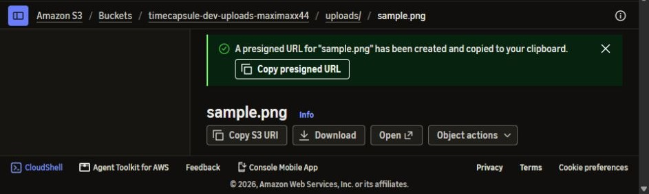

## Итоги заданий 1–6

Настроил закрытый бакет с версионированием, политикой HTTPS и правилом Lifecycle. Проверил загрузку и чтение объектов, отказ на обычный HTTP-запрос и истечение подписанной ссылки. Восстановил `notes.txt` удалением маркера и проверил откат к `v1`. Пятиминутная ссылка из консоли S3 открыла PNG в режиме инкогнито Chrome.

[Документация AWS по жизненному циклу S3](https://docs.aws.amazon.com/AmazonS3/latest/userguide/intro-lifecycle-rules.html)

## 7. Политика приложения

В регионе `eu-central-1` создал `timecapsule-dev-app-s3`. Начальная версия политики разрешает `s3:ListBucket` только для запросов с префиксом `uploads/*`. Она разрешает `s3:GetObject`, `s3:PutObject` и `s3:DeleteObject` только для `arn:aws:s3:::timecapsule-dev-uploads-maximaxx44/uploads/*`. Список относится к бакету, а чтение, запись и удаление относятся к ключам. Если поменять эти ARN местами, действие не получит подходящего разрешения.

Начальная политика доступна в [JSON](iam-policy-initial.json), итоговая — в [JSON](iam-policy-final.json).

## 8. Проверка тестовой роли

Принял роль `timecapsule-dev-s3-tester` под IAM-пользователем `cloudstudent`. Политика доверия отвечает на вопрос, кому разрешено принимать роль. Политика прав определяет, что доступно в сеансе принятой роли. Временные данные использовались только в дочернем процессе проверки.

| № | Операция | Ожидал | Получил | Правило |
| --- | --- | --- | --- | --- |
| 1 | Загрузка `uploads/test.txt` | Разрешено | Разрешено | PutObject |
| 2 | Просмотр `uploads/` | Разрешено | Разрешено | ListBucket с проверкой префикса |
| 3 | Просмотр корня бакета | AccessDenied | AccessDenied | Неявный запрет |
| 4 | Чтение `uploads/photo.txt` | Разрешено | Разрешено | GetObject |
| 5 | Просмотр `backups/` | AccessDenied | AccessDenied | Неявный запрет |
| 6 | Загрузка в `backups/` | AccessDenied | AccessDenied | Неявный запрет |
| 7 | Список версий объектов | AccessDenied | AccessDenied | Неявный запрет ListBucketVersions |
| 8 | Удаление конкретной версии | AccessDenied | AccessDenied | Неявный запрет DeleteObjectVersion |
| 9 | Удаление `uploads/test.txt` по ключу | Разрешено | Разрешено | DeleteObject |
| 10 | Просмотр `uploads/` по HTTP | AccessDenied | AccessDenied | Явный запрет в политике бакета |

Удаление по ключу скрывает объект маркером. Администратор с правом удаления конкретной версии может убрать маркер и вернуть предыдущую версию. В пределах проверенной политики приложение не может уничтожить историю версий. Полный набор прав `s3:*` потенциально разрешил бы удаление отдельных версий.


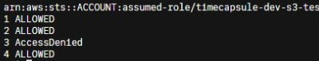

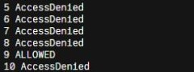

## 9. Роль EC2

Привязал `timecapsule-dev-app-role` к `timecapsule-dev-app` через instance profile. AWS CLI на EC2 подтвердил сеанс этой роли. Список `uploads/` был разрешён, список `backups/` получил `AccessDenied`. Для постоянных SSH-сеансов добавил переменную `BUCKET` в конфигурацию пользователя, если она отсутствовала.

Тестовая роль доверяет IAM-пользователю, роль сервера доверяет службе EC2. SDK и CLI на EC2 получают обновляемые временные учётные данные из метаданных экземпляра. Рабочие ключи доступа не хранятся в `.env`.

## 10. Перенос существующих вложений

Запустил `aws s3 sync storage/uploads s3://…/uploads/ --exclude .gitkeep --dryrun`, затем синхронизацию и повторный dry-run. При повторе не было файлов к копированию. Для старого объекта S3 показал `image/png` и 67 байт. SHA-256 на диске и в S3 совпал:

```text
22056e41cc4106ac582c0cc793e17b2b138ad590685718c387c4d091ae8fa75d
```

Для синхронизации потребовалось право перечисления объектов с префиксом и право записи объектов. На этапе сравнения, когда запрашиваются метаданные отдельного ключа, применяется право чтения.


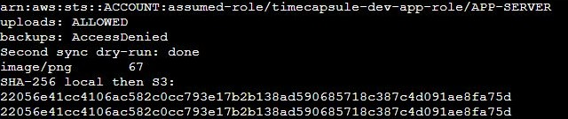

## 11. Модуль S3 и деплой

Для работы с S3 использованы AWS SDK для PHP и настройки `S3_BUCKET`, `AWS_REGION`. Модуль загружает файлы под случайным именем, удаляет по ключу и возвращает 302 на подписанный HTTPS URL на пять минут. Тип содержимого, исходное имя и режим `inline` или `attachment` подписываются вместе с запросом. В подвале страницы отображается `Amazon S3`. Релиз развернул через SSH и проверил `php -l` и `/health`.

## 12. Проверка приложения и срока ссылки

| Проверка | Результат |
| --- | --- |
| PNG | HTTP 302 от TimeCapsule и HTTP 200 от S3, `image/png`, режим `inline`, исходные байты |
| PDF | HTTP 302 и HTTP 200, `application/pdf`, режим `attachment`, имя `lab4-original.pdf` |
| Прямой адрес без подписи | HTTP 403 |
| Капсула №1 из ЛР2 | Проверил запись БД и скачал исходное вложение по подписанной ссылке SDK на EC2. SHA-256 совпал. |
| Подписанная ссылка после срока | Тот же URL через пять минут вернул HTTP 403 (`Request has expired`). |
| Удаление тестовой капсулы | Через приложение. S3 показал один актуальный delete marker и одну сохранённую версию. |

PNG и PDF проверял через HTTP-клиент с обычной сессией тестового пользователя. Для исходной капсулы проверка выполнена на сервере по записи БД и её ключу. URL в отчёте показан без подписи и токена.

Подписанный адрес даёт временный доступ предъявителю, а после срока S3 отклоняет тот же запрос. Удаление капсулы вызывает удаление объекта по ключу, что добавляет маркер. Неактуальные версии обрабатываются действующим правилом жизненного цикла.


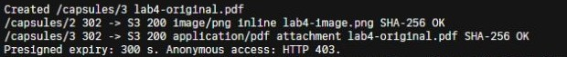


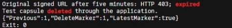

## 13. Сокращение прав и работа без диска

Переместил `storage/uploads` за пределы приложения. Проверил чтение существующей капсулы и запись новой с PNG после смены версии политики. После повторной сверки SHA-256 удалил локальный дубликат. Итоговая роль сохраняет права работы с объектами под `uploads/`, а `ListBucket` исключено.

| Запрос | Результат |
| --- | --- |
| Список `uploads/` с app-server | AccessDenied |
| Несуществующий объект с app-server | HTTP 403 |
| Тот же ключ с IAM-пользователем | HTTP 404 |

Без `ListBucket` S3 скрывает факт существования объекта, возвращая 403 при запросе отсутствующего ключа. Клиент с правом перечисления может получить 404. Для замены сервера нужны приложение, те же настройки S3 и базы и роль с доступом к бакету. Вложения при этом копировать не требуется, а сессии пока хранятся отдельно на экземпляре.


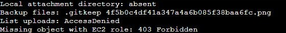

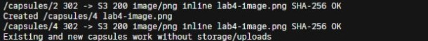

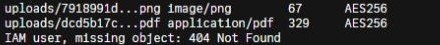

## 14. Архитектура и решение

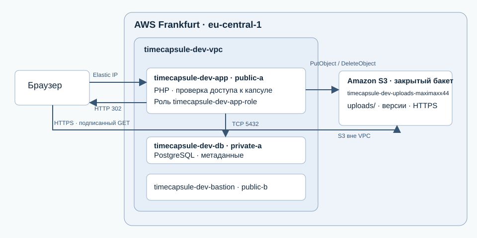

[ADR-0003. Хранение вложений TimeCapsule](../docs/adr/0003-attachment-storage.md)

### Дополнительные контрольные вопросы

**Как проходит скачивание?** Приложение проверяет сессию и правила доступа капсулы до подписания. После 302 браузер идёт в S3, где проверяются подпись, срок запроса и разрешения IAM-роли.

**Почему объект закрыт по прямому адресу?** В бакете включён Block Public Access и действует требование HTTPS. Для чтения нужен разрешённый IAM-запрос. Подписанный URL ограничивает запрос заданным ключом, параметрами и временем.

**Зачем выдавать ссылку?** Приложение решает, кто вправе получить вложение, а S3 передаёт байты напрямую. Открытый бакет обошёл бы эту проверку для любого, кто знает адрес объекта.

**Как пережить потерю региона?** Добавить бакет во втором регионе, реплицировать версии и проверить переключение приложения на него. Восстановление базы и объектов нужно согласовать, чтобы ключи в метаданных указывали на доступные версии.

## Завершение

После проверки остановил EC2 app, db и bastion и отозвал временное правило SSH для EC2 Instance Connect. В AWS все три экземпляра перешли в состояние `stopped`. Бакет хранит вложения и их версии.

