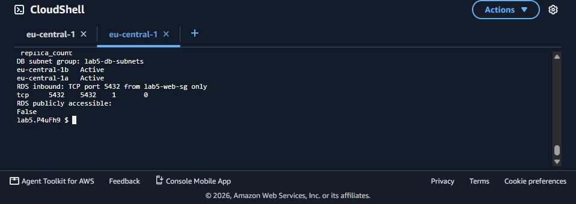
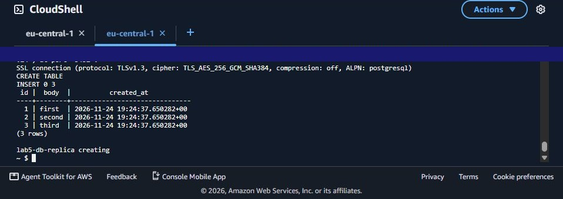
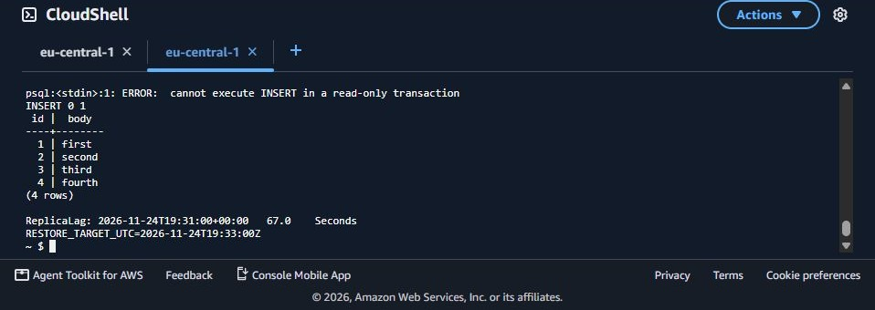
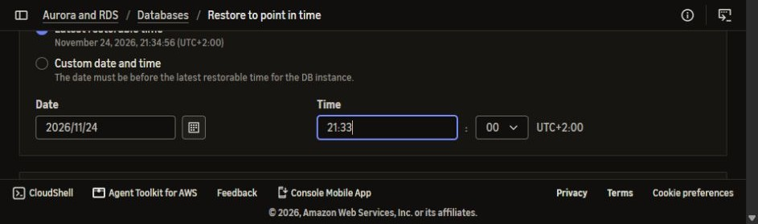
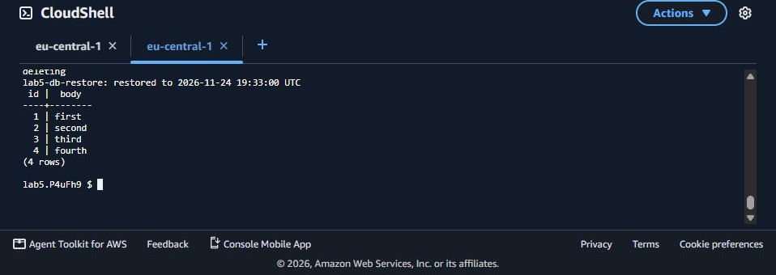

# Лабораторная работа №5 - Облачные базы данных. Amazon RDS

| Параметр | Значение |
| --- | --- |
| Студент | Максим Орлов |
| Группа | IA-2404 |
| Уровень | Базовый, задания 1-5 |
| Регион | Франкфурт, `eu-central-1` |

[Условие задания в Moodle](https://elearning.usm.md/mod/assign/view.php?id=344592)

## 1. Приватные подсети и сетевой доступ

Создал `lab5-db-subnets` из двух приватных подсетей VPC из ЛР3 в `eu-central-1a` и `eu-central-1b`. Единственное входящее правило `lab5-rds-sg` разрешало TCP 5432 от группы `lab5-web-sg`, которую назначил учебному EC2. Ресурсы пометил тегом `Lab=lab5`.



Правило по группе безопасности продолжает действовать при смене IP веб-сервера. Две подсети в разных зонах дают RDS возможность разместить основной экземпляр и реплику отдельно. Основной экземпляр при этом работает в одной зоне.

## 2. Основной экземпляр

| Настройка | Значение |
| --- | --- |
| Экземпляр | `lab5-db` |
| СУБД | PostgreSQL 18.6 |
| Класс и диск | `db.t4g.micro`, gp3, 20 ГиБ |
| Зона | `eu-central-1a`, Single-AZ |
| База и администратор | `lab5`, `dbadmin` |
| Публичный доступ и авторасширение диска | Выключены |
| Хранение резервных копий | 7 дней |
| Шифрование и защита от удаления | Включены |

Создал экземпляр через AWS CLI с параметрами учебной конфигурации. Проверил, что база приватная и к ней подключается EC2 из разрешённой группы. Основная база и учебный EC2 размещены в одной зоне. Защита от удаления блокирует удаление экземпляра RDS, но SQL по-прежнему позволяет удалить строки или таблицы.

## 3. Подключение и тестовые данные

Запустил `psql` на учебном EC2. `SELECT version()` подтвердил PostgreSQL 18.6, а `\conninfo` показал подключение к `lab5` на TCP 5432 с TLS 1.3.

```sql
CREATE TABLE notes (
    id SERIAL PRIMARY KEY,
    body VARCHAR(100) NOT NULL,
    created_at TIMESTAMPTZ NOT NULL DEFAULT now()
);

INSERT INTO notes (body) VALUES ('first'), ('second'), ('third');
SELECT * FROM notes ORDER BY id;
```



DNS внутри VPC и при отдельной проверке вне VPC вернул один и тот же приватный IPv4-адрес. Локальный DNS-запрос с Windows завершился тайм-аутом, поэтому для сравнения использовал DNS-запрос из внешней среды. SQL выполнял на EC2.

## 4. Реплика для чтения

Создал приватную `lab5-db-replica` класса `db.t4g.micro` в `eu-central-1b`. На основной базе `pg_is_in_recovery()` вернул `false`, на реплике `true`. Реплика показала три исходные строки. Попытка выполнить `INSERT` на ней завершилась ошибкой `cannot execute INSERT in a read-only transaction`. После записи `fourth` в основную базу строка появилась и на реплике. CloudWatch показал `ReplicaLag` 67 секунд для точки 19:31 UTC.



Реплика получает изменения асинхронно и обслуживает запросы чтения. В обычном RDS Multi-AZ DB instance резервный экземпляр предназначен для автоматического переключения при отказе, и запросы чтения на него напрямую не направляются.

## 5. Восстановление после удаления

Зафиксировал точку **24 ноября 2026, 19:33:00 UTC**. Через минуту удалил все строки из `notes`. Основная база и реплика показали по ноль строк, после чего удалил реплику. Когда `Latest restorable time` дошло до 19:34:56 UTC, запустил восстановление через AWS CLI на 19:33:00 UTC. В форме консоли это 21:33:00 по Кишинёву.



Создал `lab5-db-restore` в `eu-central-1a`, без публичного доступа, с той же группой подсетей и тем же правилом доступа. Запрос к копии вернул все четыре строки: `first`, `second`, `third` и `fourth`.



Реплика не спасла данные, потому что повторила удаление с основной базы. Восстановление создаёт отдельный экземпляр, чтобы можно было проверить историческое состояние и решить, переносить ли на него рабочие подключения.

## Завершение

Удалил реплику, копию и основную базу без финальных снимков и без сохранения автоматических резервных копий. Для основной базы сначала отключил защиту от удаления. Завершил учебный EC2 и удалил учебные группы безопасности и подсетей. AWS подтвердил отсутствие экземпляров RDS, сохранённых бэкапов, ручных снимков и EBS-томов ЛР5. При последней проверке в списке снимков ещё отображались две записи типа `automated`.
